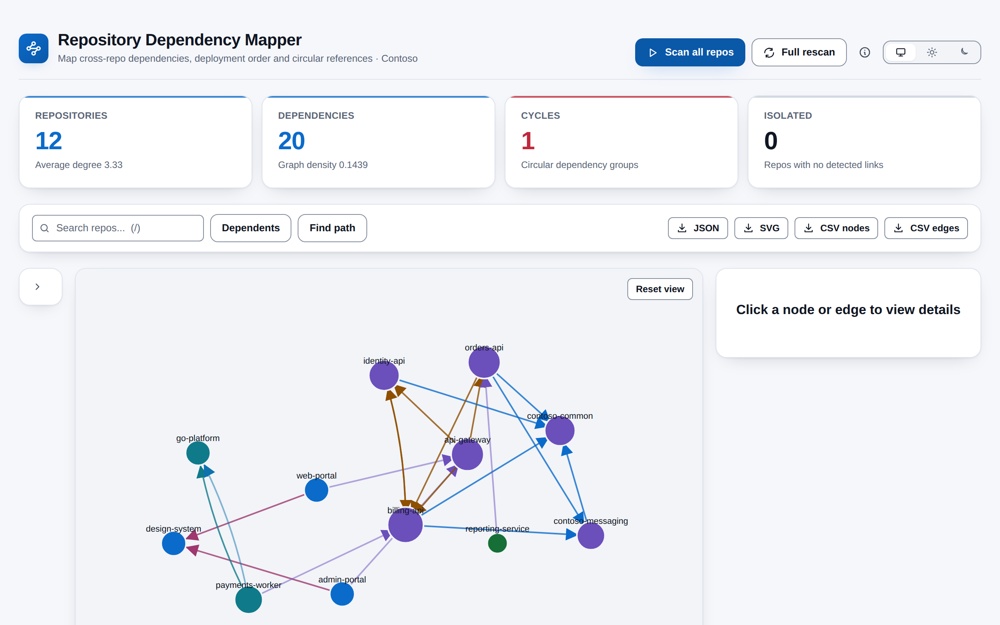
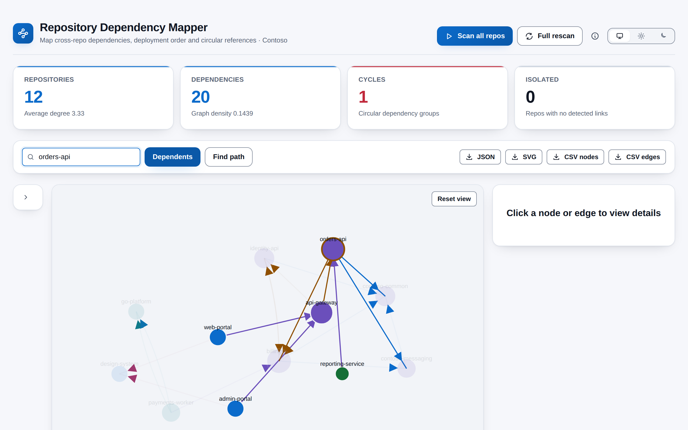
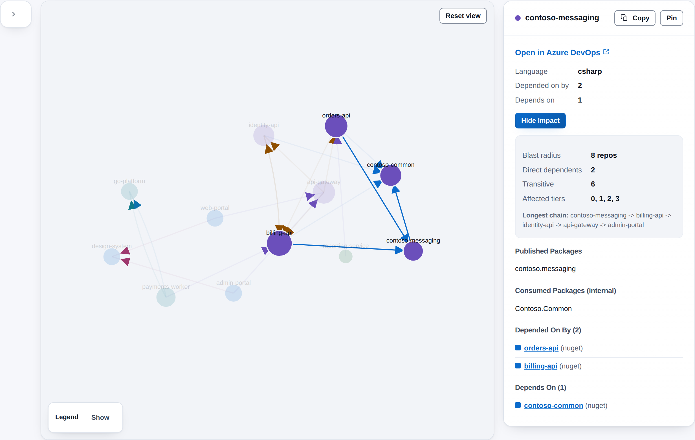
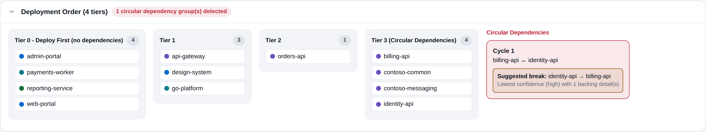

# Repository Dependency Mapper

[](https://github.com/adam-wheater/azure-devops-repo-dependency-mapper/actions/workflows/ci.yml)

An Azure DevOps extension that scans every Git repository in a project, works out which repositories depend on which, and draws the result as an interactive graph. Fourteen detectors read package manifests, Dockerfiles, Helm charts, pipelines, Bicep and ARM templates, app settings and C# source for NuGet, npm, Go, Maven and Gradle, Python, Docker, Helm, HTTP, database, Azure infrastructure, App Configuration, service connection, Service Bus and shared-service links. From the graph it finds circular dependencies, groups repositories into deployment tiers, and answers two questions on demand: *what breaks if I change this repository?* and *how does repository A reach repository B?* It is built for platform teams, architects and tech leads who inherit a project with dozens of repositories and no map. Everything runs in the browser from a hub under **Repos > Dependencies**.



## Table of contents

- [Getting started](#getting-started)
- [Features](#features)
- [Screens](#screens)
  - [Header, progress and messages](#header-progress-and-messages)
  - [Summary tiles](#summary-tiles)
  - [Toolbar, search and export](#toolbar-search-and-export)
  - [Dependency graph](#dependency-graph)
  - [Filters](#filters)
  - [Details panel](#details-panel)
  - [Path finder](#path-finder)
  - [Deployment order](#deployment-order)
  - [Keyboard shortcuts](#keyboard-shortcuts)
- [How it works](#how-it-works)
- [Settings](#settings)
- [Rules and detection logic](#rules-and-detection-logic)
- [Scopes & permissions](#scopes--permissions)
- [Privacy](#privacy)
- [Troubleshooting and known limitations](#troubleshooting-and-known-limitations)
- [Development](#development)
- [Project structure](#project-structure)
- [Tech stack](#tech-stack)
- [Contributing](#contributing)
- [License](#license)

## Getting started

1. Install **Repository Dependency Mapper** by publisher `adam-wheater` from the Visual Studio Marketplace (the listing carries the **Preview** flag).
2. Open a project. The hub is contributed to the **Repos** hub group (`ms.vss-code-web.code-hub-group`, order 99) and appears last in the Repos menu as **Dependencies**.
3. On first open, the app shows an empty canvas, or the graph from your last scan in this browser if it is under 30 minutes old. Press **Scan all repos**. The first scan reads every repository; the progress card shows how far it has got.
4. Explore: search, switch to **Dependents**, click a node and **Analyze Impact**, open **Find path**, expand **Deployment Order**, and export what you need.
5. Press **Full rescan** whenever you want a complete picture (see the [limitations](#troubleshooting-and-known-limitations) on incremental scans).

## Features

- **14 detectors** -- NuGet, npm, Go modules, Maven and Gradle, Python, Docker, Helm, API calls, databases, Azure infrastructure, App Configuration, service connections, Service Bus and shared services.
- **Two-pass cross-referencing** -- The first pass records what each repository publishes (NuGet ids, npm names, Go modules, Maven coordinates, Python packages). The second pass resolves every reference against that registry, so an exact match is High confidence and a name guess is Medium or Low.
- **Interactive force graph** -- Drag, pan, zoom (0.1x to 4x), click a node or an edge for details, double-click a node to open the repository, pin nodes in place.
- **Confidence you can see** -- Edge opacity follows High, Medium and Low confidence, edge width follows how many findings back it, and parallel edges between the same pair curve apart.
- **Circular dependency detection** -- Strongly connected groups are found with an iterative Tarjan search, and each group suggests the weakest edge to break.
- **Deployment tiers** -- Repositories are layered with Kahn's algorithm, with any remaining cycle collected into a final tier (see [limitations](#troubleshooting-and-known-limitations) for how to read the labels).
- **Impact analysis** -- Pick a repository and see its direct and transitive dependents, the tiers they sit in, and the longest chain through them.
- **Path finder** -- Shortest path or every path (up to 10 hops, up to 1,000 results) from one repository to another.
- **Search and reverse search** -- Dim everything but the repositories whose name matches, or switch to **Dependents** to light up everything that depends on the match.
- **Filters** -- By dependency type, minimum confidence, language and repository, with an option to hide isolated repositories.
- **Change banner** -- When a scan finishes and a graph was already on screen, a banner counts edges added, removed and changed, and the graph draws new edges and nodes in a distinct style.
- **Exports** -- JSON, SVG, nodes CSV and edges CSV, with CSV formula-injection protection.
- **Cancellable, concurrent scanning** -- Up to 5 repositories and 10 files in flight at once; **Cancel** stops the scan between repositories.
- **Browser cache** -- The last graph and the repository HEAD commits are kept in `localStorage` for 30 minutes.
- **Theme follows Azure DevOps** -- Light, dark and high contrast come from the host's `themeApplied` event, with a header toggle to pin light or dark. The graph takes every colour from the same `--ax-*` tokens, so it re-themes with the page.
- **WCAG AA contrast** -- Both palettes are audited to 4.5:1 for text and 3:1 for UI. Dependency types and languages are always named in text beside their colour.

## Screens

The app is a single page with no tabs. The header holds the brand mark, title, subtitle (tagline plus project name), the scan buttons, a keyboard-shortcuts button and the theme toggle. The filters, graph and details panel are always there, with empty states before the first scan. The summary tiles and the deployment order appear once there is a graph to show. Below 1,100 px wide the filters, graph and details stack in one column with the graph first.

### Header, progress and messages

- **Scan all repos** (primary) starts a scan. While a scan runs it reads **Scanning...** with a spinner and is disabled.
- **Full rescan** ignores the cached commits and reads every repository.
- **Cancel** (red) appears only while a scan runs.
- The information button opens the [keyboard shortcuts](#keyboard-shortcuts) dialog.
- The progress card shows the current message ("Fetching repositories...", "Scanning <repo>...", "Scanned x of N repositories...") with an `x / N` count. When the total is not known yet the bar is indeterminate.
- If a repository's scan fails part-way, an **N failed** disclosure under the progress bar lists it. The progress card disappears when the scan ends, so the list is visible only while the scan runs; the details are in the browser console.
- Errors appear in a dismissible red banner: "Scan failed: <reason>", or "Scan was cancelled." after **Cancel**.
- When a scan replaces an existing graph and anything changed, an information banner reads "Changes since the previous scan" with counts such as `+3 -1 ~2 edges, +1 repos`. **~** counts edges whose confidence changed.
- Results from the previous scan stay on screen until the new scan replaces them.
- A footer reads "Runs entirely in your browser · no data leaves Azure DevOps".

### Summary tiles

Shown once a graph exists. They describe the whole graph, not the filtered view.

| Tile | Value | Hint and tone |
|------|-------|---------------|
| **Repositories** | Repositories in the project. | "Average degree n" (accent). |
| **Dependencies** | Edges in the graph. | "Graph density n" (info). |
| **Cycles** | Circular dependency groups. | Danger with "Circular dependency groups" when above 0, success with "No circular dependencies" at 0. |
| **Isolated** | Repositories with no detected link in either direction. | Neutral, "Repos with no detected links". |

Average degree is in plus out edges per repository, and density is distinct directed pairs divided by the pairs possible.

### Toolbar, search and export



- **Search** matches repository names (case-insensitive substring) after a 300 ms pause and dims every other node to 15 % opacity. Press `/` to focus it and `Escape` to clear it.
- **Dependents** switches the search to reverse mode. Repositories matching the text are ringed in the warning colour, and every repository that depends on one of them, directly or through a chain, stays lit. Everything else fades.
- **Find path** (shown once a graph exists) opens the [path finder](#path-finder).
- **Export** (shown once a graph exists):

| Button | File | Content |
|--------|------|---------|
| **JSON** | `dependency-graph-<timestamp>.json` | The whole graph: nodes, edges, deployment tiers, cycles and statistics. |
| **SVG** | `dependency-graph-<timestamp>.svg` | The graph as currently drawn, filters, zoom and pan included, with computed colours written into the file so it renders outside the page. |
| **CSV nodes** | `dependency-nodes-<timestamp>.csv` | `name,language,inDegree,outDegree,tier` for every repository. |
| **CSV edges** | `dependency-edges-<timestamp>.csv` | `source,target,type,confidence,weight,detail`, with the finding descriptions joined by `; `. |

A CSV cell that starts with `=`, `+`, `-`, `@`, a tab or a carriage return gets a leading `'` so a spreadsheet cannot run it as a formula.

### Dependency graph

A d3 force layout in an SVG with `role="img"`.

- **Nodes** are coloured by language and sized by degree. Labels sit above each node.
- **Edges** are coloured by dependency type, with an arrowhead pointing at the repository being depended on. Opacity is 0.8, 0.5 or 0.25 for High, Medium and Low confidence, and width grows with the number of findings (capped at 6).
- **Click a node** to select it: the details panel opens and everything not connected to it fades. **Click an edge** for the edge details. **Click the background** or press `Escape` to clear.
- **Double-click a node** opens the repository in Azure DevOps in a new tab.
- **Drag** a node to move it; **scroll** to zoom and drag the background to pan. **Reset view** returns to the default view.
- **Pin** (in the details panel) holds a node where it is. **Unpin all (n)** appears while any node is pinned.
- **Arrow keys** step through the nodes while focus is not in a form field, and `Enter` re-selects the current one.
- **After a re-scan**, edges that are new are drawn dashed in the success colour, edges whose confidence changed are dashed in the warning colour, and new repositories get a success-coloured ring. Removed edges are counted in the banner but not drawn.
- With 100 or more nodes, nodes and edges outside the viewport are hidden while the layout settles.
- The **Legend** at the bottom left names every edge colour and language colour. **Hide** collapses it, and on narrow screens the Nodes key drops under the Edges key.
- "Rendering graph..." shows while the layout settles. When nothing matches the filters the canvas reads "No results match current filters", and before the first scan it reads "No dependency graph yet".

### Filters

The left card collapses to a thin strip with its chevron button (**Collapse filters** / **Expand filters**).

| Control | Behaviour |
|---------|-----------|
| **Dependency type** | One checkbox per type (14), all on by default, with **All** and **None**. A swatch shows the edge colour. |
| **Confidence** | **Low+** (everything), **Medium+** or **High only**. |
| **Show isolated repos** | When off, repositories with no visible edge are hidden. |
| **Languages** | C#, Go, TypeScript, Java, Python and Unknown, with **All** and **None**. Hides repositories of the unticked languages. |
| **Repositories (n)** | A filter box over a scrolling checklist. Ticking repositories keeps only the edges that touch a ticked repository. **All** removes the restriction; **None** hides everything. |

Filters change only what is drawn, and so the **Export > SVG** file. The summary tiles, JSON and CSV exports, details lists and deployment order always use the full graph.

### Details panel



Shows "Click a node or edge to view details" until something is selected.

**For a repository:**

- The name with its language colour, **Copy** (copies the name) and **Pin** / **Unpin**.
- **Open in Azure DevOps** (the repository's web URL, in a new tab).
- Language, **Depended on by** (in-degree) and **Depends on** (out-degree).
- **Analyze Impact** / **Hide Impact**:

| Field | Meaning |
|-------|---------|
| **Blast radius** | Repositories that depend on this one, directly or through a chain. |
| **Direct dependents** | Repositories with an edge straight to it. |
| **Transitive** | The rest of the blast radius. |
| **Affected tiers** | Deployment tiers that contain a dependent. |
| **Longest chain** | The longest path through dependents, shown when it has more than one repository. |

- **Azure Resources Deployed** -- resources the repository's Bicep, ARM, pipelines or PowerShell provision or reference, with their source file. Shown for the latest scan only; a graph restored from the cache has none.
- **Services Used** -- shared service instances (Redis, Azure Storage, Cosmos DB, Key Vault and so on) with where each was detected.
- **Databases**, **Published Packages** (NuGet packages the repository publishes) and **Consumed Packages (internal)** (NuGet and Maven packages it takes from another repository in the project).
- **Depended On By (n)** and **Depends On (n)** -- every edge with a type swatch. The repository name is a link that selects that repository.

**For an edge:** `source -> target`, a pill with the dependency type, the confidence, and **Details (n)** listing each finding's description, version and source file.

### Path finder

Opened with **Find path**. Pick a **Source** and a **Target** from the repository lists.

- **Find shortest path** runs a breadth-first search and shows one path.
- **Find all paths** runs a depth-first search that never revisits a repository within a path, stops at 10 hops and returns at most 1,000 paths.
- Both buttons stay disabled until two different repositories are chosen. Results read "n path(s) found" with each path as a chain of repository names (the ends in bold), or "No path found from X to Y." when there is none. **Clear** removes the results.
- Paths follow the edge direction: from a repository to the repositories it depends on.

### Deployment order



A collapsed disclosure, **Deployment Order (n tiers)**, with a red pill when cycles exist. Opened, it shows one column per tier (label, repository count and the repositories with their language colour). Cycles get a **Circular Dependencies** column: each cycle lists its repositories joined by `↔` and a **Suggested break** with the edge to cut and the reason, for example "Lowest confidence (low) with 1 backing detail(s)".

### Keyboard shortcuts

| Key | Action |
|-----|--------|
| `/` | Focus the search box. |
| `Escape` | Clear the search and the selection, or close a dialog. |
| `?` | Open or close the shortcuts dialog (not while typing in a field). |
| `Tab` | With the graph focused: select the first repository, then step through the selected one's links (`Shift+Tab` goes back). |
| Arrow keys, `Enter` | Step through the nodes, and show the selected one's details. |

## How it works

```
   SDK.init() -> SDK.ready() --> ThemeProvider (data-theme / data-contrast) --> <App/>
        |
        |  on load: IProjectPageService.getProject()
        |           cached graph for this project (localStorage, 30 min) -> show it
        v
   [Scan all repos]  /  [Full rescan]
        |
        v
   GitRestClient.getRepositories                 (all repos in the project)
        |
        |  Scan all repos only: getRefs / getRepository -> HEAD commit per repo,
        |  skip repos whose HEAD matches the previous scan (see limitations)
        v
   Phase 1, per repo (5 at a time)
     getItems (full recursion) -> classify files: config / infra / source
     getItemText (10 at a time, files over 1 MB skipped)
     every detector.registerPublished(...)       -> who publishes what
        |
        v
   Phase 2, per repo: every detector.detect(...) on every fetched file
        |
        v
   Phase 3: crossLinkInfraAndUsage  (provisioner <-> consumer Infrastructure edges)
        |
        v
   buildGraph  -> nodes, edges, CycleDetector, TopologicalSort, stats
        |
        +-- diffGraphs(previous, new)  -> change banner, added / changed styling
        +-- cache.set("last-graph:<project>")
        v
   ForceGraph (d3) + Filters + Details + Deployment order
```

1. **SDK init.** `src/DependencyHub/DependencyHub.tsx` runs `SDK.init()` and `SDK.ready()` and renders `<App/>` inside `ThemeProvider`. If the handshake fails, a plain-DOM message ("Repository Dependency Mapper could not connect to Azure DevOps. Refresh the page to try again.") and the error text are shown.
2. **Project context and cache.** On load the app asks `IProjectPageService.getProject()` for the project name (shown in the subtitle) and, if a graph for that project was cached less than 30 minutes ago, shows it straight away. Nothing is scanned until you press a scan button.
3. **Discovery.** `ScanOrchestrator` lists the project's repositories. Unless you chose **Full rescan**, it also asks for each repository's HEAD commit (branch `main`, falling back to the repository's default branch) and drops repositories whose commit matches the one recorded by the previous scan.
4. **Phase 1: fetch and register.** For each remaining repository, up to 5 at a time, `discoverFiles` lists every item and sorts files into config, source and infrastructure by path pattern (see [Rules and detection logic](#rules-and-detection-logic)). The language is chosen from the config files found. Config and infrastructure files are fetched, 10 files at a time; source files (`.cs`, `.go`) are fetched only when the repository has at least one config or infrastructure file. Files larger than 1 MB are skipped. Each detector then records what the repository publishes.
5. **Phase 2: detect.** Once every repository has been registered, each fetched file is passed to all 14 detectors, one repository at a time. A detector that throws on a file is logged and skipped, and a repository whose scan throws is listed under **N failed**.
6. **Phase 3: cross-link.** Infrastructure provisioned by one repository (Bicep, ARM, pipelines, PowerShell) is matched against the services other repositories consume, producing Infrastructure edges from the consumer to the provisioner.
7. **Graph build.** `buildGraph` merges findings into one edge per source, target and type (the edge takes the best confidence among its findings, and its weight is the number of findings), drops self-loops and findings that point outside the repository list, then computes degrees, cycles, tiers and statistics.
8. **Cancellation.** The `AbortSignal` is checked between phases and before each repository. A cancelled scan shows "Scan was cancelled."; requests already in flight finish. Results from an aborted scan are ignored.
9. **Persistence.** The graph and the HEAD commits are cached under `dep-mapper-` keys in `localStorage`. The cache also tries to mirror itself to the Extension Data Service and ignores any failure.

## Settings

The extension has no settings of its own to configure. What it keeps, and where:

| Item | Where | Lifetime |
|------|-------|----------|
| Last graph for the project | Browser `localStorage`, key `dep-mapper-last-graph:<project>` | 30 minutes, then ignored and removed. |
| HEAD commit per repository | Browser `localStorage`, key `dep-mapper-scan-commits-<project>` | 30 minutes. |
| Pinned theme (`light` / `dark`) | Browser `localStorage`, key `repo-dependency-mapper.theme` | Until cleared; absent means follow Azure DevOps. |
| Filters, search text, pins, selection | Memory | Until you leave the page. |

When `localStorage` is full, the oldest cache entries are evicted (at least 3, or half of them) and the write is retried.

Limits that are fixed in `src/utils/Constants.ts` and the analysis modules: 5 repositories and 10 files in flight, files up to 1 MB, a 4-character minimum for name matching, path finding up to 10 hops and 1,000 results.

## Rules and detection logic

**File discovery.** All files in a repository's default branch are listed recursively and sorted by path:

- **Config files** -- `.csproj`, `.fsproj`, `.vbproj`, `.sln`, `packages.config`, `.nuspec`, `appsettings*.json`, `go.mod`, `go.sum`, `.sqlproj`, `Directory.Build.props`, `Directory.Packages.props`, `package.json`, `pom.xml`, `build.gradle` and `build.gradle.kts`, `requirements.txt`, `pyproject.toml`, `setup.py`, `Pipfile`, `Chart.yaml`, `values.yaml`.
- **Infrastructure files** (when not already config) -- `.bicep`, `azure-pipelines.yml`, `.azure/pipelines/*.yml`, `pipelines/*.yml`, `deploy*.ps1`, `infra*.ps1`, `azuredeploy.json`, `mainTemplate.json`, `Dockerfile`, `docker-compose.yml`, `templates/*.yml`.
- **Source files** -- `.cs` and `.go`, fetched only when the repository has config or infrastructure files. Only `.cs` files are analysed (by the API call, database and service usage detectors).

**Language** is the first match, in this order: a `.csproj` gives C#; `go.mod` gives Go; `pom.xml` or Gradle gives Java; `requirements.txt`, `pyproject.toml` or `setup.py` gives Python; `package.json` gives TypeScript; anything else is Unknown.

**Edge direction.** In every edge, the source depends on the target. An arrow points at the repository being depended on.

**Matching.** An exact match against what another repository publishes is High confidence. Otherwise a name heuristic compares the package, image or host name with every repository name after lowercasing and removing `-`, `_`, `.`, `@` and `/`. It accepts an exact match, a substring match when the shorter name is at least 40 % of the longer one, or a segment match covering at least 60 % of the repository's name segments. Names under 4 characters are never matched. Heuristic matches are Medium or Low.

| Detector (type) | Reads | Finds | Confidence |
|-----------------|-------|-------|------------|
| **NuGet** (`nuget`) | Fetched files, mainly `.csproj`, `packages.config`, `Directory.Packages.props` and `.nuspec` | `PackageReference`, `ProjectReference`, `Import Project` and `PackageVersion` entries. Publishes via `PackageId`, `.nuspec` `id`, or `AssemblyName` as a fallback, and skips projects marked `IsPackable` false. | High for a package another repository publishes; Medium for a name match. |
| **npm** (`npm`) | `package.json` (not under `node_modules/`) | `dependencies` and `peerDependencies` (not `devDependencies`) against other repositories' `name`. | High exact; Medium name match. |
| **Go modules** (`go-module`) | `go.mod` | `require` lines that share the repository's own org prefix (host and org, plus the project on paths of four or more segments; a `/vN` suffix is ignored), against other repositories' module paths. | High exact; Medium name match. |
| **Maven / Gradle** (`maven`) | `pom.xml`, `build.gradle`, `build.gradle.kts` | Dependencies against other repositories' `groupId:artifactId`. | High exact; Medium name match. |
| **Python** (`python`) | `requirements.txt`, `pyproject.toml`, `setup.py`, `Pipfile` | Requirements against other repositories' package names. | High exact; Medium name match. |
| **Docker** (`docker`) | `Dockerfile`, `docker-compose.yml` | `FROM` and compose `image` (Medium), `COPY --from` and compose `depends_on` (Low), when the image or service name matches a repository. | Medium or Low. |
| **Helm** (`helm`) | `Chart.yaml`, `values.yaml` | Chart `dependencies` (High); image and service references in `values.yaml` (Medium). | High or Medium. |
| **API calls** (`api`) | `.cs` files, `appsettings*.json` | `HttpClient` URLs, RestSharp, Refit and gRPC clients (Medium), named and factory clients (Low), and URLs under sections such as `ServiceUrls`, `Services`, `Endpoints` or `Clients` whose host or path matches a repository (High) or whose key does (Medium). | High, Medium or Low. |
| **Databases** (`database`) | `appsettings*.json`, `.cs`, fetched YAML (compose files, pipelines, `values.yaml`), `.sqlproj` | Repositories that name the same database in connection strings, `DbContext` registrations, `GetConnectionString` calls or config keys (High), or call the same stored procedure (Medium). Linked in both directions. | High or Medium. |
| **Infrastructure** (`infrastructure`) | `.bicep`, ARM templates, pipeline YAML, `.ps1` | Bicep modules, pipeline `checkout`, template and `repositories` references from another repository (High), upstream pipeline triggers (Medium), repositories that deploy the same Azure resource (High). Resources are listed in the details panel. | High or Medium. |
| **App Configuration** (`app-config`) | Pipeline YAML | Repositories that run `az appconfig kv set` or `set-keyvault` against the same store, linked in both directions. | High. |
| **Service connection** (`service-connection`) | Pipeline YAML | Repositories that use the same Azure DevOps service connection in common task inputs, linked in both directions. | High; Medium when the name is a variable. |
| **Service Bus** (`service-bus`) | `.cs`, pipeline YAML | Topics and subscriptions created by pipelines or templates, and named by C# listeners and senders. A consumer links to the provisioner (High), and repositories that share a subscription (Medium) or a topic (Low) link to each other. | High, Medium or Low. |
| **Service usage** (`service-usage`) | `.csproj`, `appsettings*.json`, `.cs` | Repositories that use the same named instance of Redis, Azure Storage, Cosmos DB, Key Vault, Application Insights, Event Hubs, SignalR and similar, linked in both directions. | High. |

**Cross-linking.** After detection, resources a repository provisions (Redis, SQL, storage, Key Vault, Service Bus, Event Hubs, Cosmos DB, Application Insights, SignalR, App Configuration) are matched by name against Bicep `existing` references (High) and against the service instances other repositories consume (Medium). Each match becomes an Infrastructure edge from the consumer to the provisioner.

**Graph rules.**

- Findings are merged per source, target and type. The edge confidence is the best of its findings and its weight is the finding count.
- **Cycles** are strongly connected groups of two or more repositories. For each, the suggested break is the edge with the lowest confidence, then the lowest weight.
- **Tiers** come from Kahn's algorithm over the edges. A repository joins the first tier in which none of its remaining incoming edges are left. If every remaining repository sits in a cycle, they are collected into a final tier labelled "Circular Dependencies".
- **Diff** matches edges by source, target and type: an edge missing before is added, one missing now is removed, and one with a different confidence is changed.

## Scopes & permissions

| Scope | API calls that need it |
|-------|------------------------|
| `vso.code` | `GitRestClient.getRepositories`, `getItems` (recursive listing), `getItemText` (file contents), `getRefs` and `getRepository` (HEAD commit lookup). Read only. |

The project name comes from the host `IProjectPageService`. The manifest requests no extension-data scope. The cache's attempt to mirror itself to the Extension Data Service is wrapped so that any refusal is ignored, and nothing is ever read back from it; the app reads only the browser copy.

The extension never writes to a repository.

## Privacy

Everything runs in the browser inside the Azure DevOps extension iframe. Repository listings and file contents are read from your organisation's Azure DevOps REST API and never leave it. There is no backend, no telemetry and no call to any third-party host, and the extension never modifies a repository.

| Data | Where | Scope |
|------|-------|-------|
| The last graph (repository names, URLs, package names, database and service names, resource names) | Browser `localStorage`, key `dep-mapper-last-graph:<project>` | This browser only, 30 minutes. |
| HEAD commit per repository | Browser `localStorage`, key `dep-mapper-scan-commits-<project>` | This browser only, 30 minutes. |
| The same entries, mirrored best effort | Extension Data Service, same keys | Not read back by the extension. Refused or failed writes are ignored. |
| Pinned theme (`light` / `dark`) | Browser `localStorage`, key `repo-dependency-mapper.theme` | This browser only. |

File contents are processed in memory and discarded after each repository is analysed. Exports are generated in the browser and saved by the download you trigger.

## Troubleshooting and known limitations

- **Incremental scans are not merged.** **Scan all repos** (without **Full rescan**) re-reads only repositories whose HEAD commit differs from the one the previous scan recorded in the last 30 minutes, and builds the graph from what it read. Cached results for the skipped repositories are not merged back. After a scan that skipped repositories their edges can be missing, and the change banner reports them as removed. Use **Full rescan** for a complete graph.
- **Tier labels run against the edge direction.** Tier 0 is labelled "Deploy First (no dependencies)" and the last tier "Deploy Last", but the tiers are built from repositories that no other repository depends on, outwards to the most depended-on ones. Tier 0 therefore holds the top-level consumers and the last tier holds the shared foundations. Read the tier number as distance from the consumers, and check the direction before using the order to plan a release.
- **Shared-resource links create two-repository cycles.** Shared databases, App Configuration stores, service connections, service instances and Service Bus entities are linked in both directions, so every pair of repositories that shares one appears as a cycle and lands in the final tier. Filter by dependency type to see the real dependency chains without them.
- **Name matching is a heuristic.** A package, image or host name that happens to resemble a repository name is linked at Medium or Low confidence. Use **Confidence: High only** to keep the findings that came from an exact publisher match or an explicit reference. Names under 4 characters are never matched, so a repository called `api` or `db` is only found through exact matches.
- **Only repositories in the project can be targets.** A reference to a repository in another project or organisation is not resolved, and a package from a public feed is linked only if its name happens to resemble one of your repository names.
- **Only the default branch is read**, and only the file types listed under [Rules and detection logic](#rules-and-detection-logic). Files over 1 MB are skipped and `.go` source files are fetched but not analysed.
- **`devDependencies` are ignored** by the npm detector.
- **The 30-minute cache is per browser.** A graph restored from the cache has no Azure resource list in the details panel until you scan again.
- **Large graphs get slow.** The layout and the SVG are not virtualised beyond hiding off-screen nodes at 100 or more. Use the filters to narrow a very large project.
- **The path finder follows edge direction** and stops at 10 hops and 1,000 paths.
- **Cancel does not abort in-flight requests.** It stops new ones; the previous results stay visible.
- **Edge colours are close for some types.** Fourteen types share six base hues, so several are mixes. The legend, filters and details always name the type.
- **"Could not determine the current project..."** means the hub was opened outside a project.
- **"Scan failed: ..."** carries the underlying error, often a permission or network failure. Open the browser console for the full detail.
- **"Repository Dependency Mapper could not connect to Azure DevOps."** means `SDK.init()` failed; refresh the page.
- **"N failed"** under the progress bar lists repositories whose scan threw an error part-way, while the scan runs. The rest of the graph is still built, and the browser console keeps the error.
- **A failed file listing or download is treated as empty.** If the Azure DevOps API refuses to list a repository's files or return a file, a warning is logged to the browser console and the repository (or file) simply contributes nothing, instead of being reported under **N failed**. A repository that shows no links at all may be one of these.
- **Re-consent.** If a future version changes the requested scopes, organisation administrators must re-authorise the extension in **Organization settings > Extensions**.

## Development

### Prerequisites

- Node.js 20 or later (`engines.node >= 20`) and npm.
- Install with `npm ci --legacy-peer-deps` (or `npm install --legacy-peer-deps`). The flag is required because of the Azure DevOps SDK and React 18 peer ranges, and CI uses it too.

### npm scripts

| Script | What it does |
|--------|--------------|
| `npm run build` | Production webpack build into `dist/`; `postbuild` runs `scripts/verify-bundle.js`, then `scripts/third-party-notices.js`. |
| `npm run build:dev` | Development build with source maps (CSS still extracted to a file). |
| `npm run screenshots` | Builds the hub on sample data and saves the screenshots to `static/screenshots/` (see below). |
| `npm run verify:bundle` | Re-checks an existing `dist/` without rebuilding. |
| `npm run package` | `tfx extension create` -> `out/*.vsix`. |
| `npm test` | Jest, all projects, verbose. |
| `npm run lint` / `npm run lint:fix` | ESLint 9 flat config over `src/` and `tests/`. |
| `npm run format` / `npm run format:check` | Prettier over `src/**/*.{ts,tsx,css}` and `tests/**/*.{ts,tsx}`. |
| `npm run publish:marketplace` | `tfx extension publish` with `vss-extension.json`. |

### Run it locally with sample data

`demo/` builds the real hub against stand-ins for the Azure DevOps SDK and REST clients, filled with a fictional "Contoso" project. Its twelve repositories hold real `.csproj`, `package.json`, `go.mod`, Dockerfile, Helm and `appsettings.json` files that reference each other, so the real detectors build the graph. Use it to try the UI without an organisation, and to refresh the screenshots:

```sh
npm i --no-save playwright && npx playwright install chromium   # once
npm run screenshots
```

After that, open `demo/dist/DependencyHub/DependencyHub.html` in a browser, press **Scan all repos** and click around. `demo/api.ts` holds the sample files and `demo/shots.json` lists the screenshots; the other files in `demo/` are the same in every extension. The graph needs a few seconds to settle after a scan, so each shot waits before it captures. Nothing in `demo/` ships in the package.

### `build.ps1`

`build.ps1` is the same script in every extension repository (it reads the product name from `vss-extension.json`) and runs the CI steps locally, in CI order:

1. `npm ci --legacy-peer-deps` (the same install as `ci.yml`).
2. `npm run lint` and `npm run format:check`.
3. `npm test`.
4. Bump the version in `vss-extension.json`, `package.json` and both root entries of `package-lock.json` (semver patch +1, e.g. 1.0.9 -> 1.0.10). If any later step fails, all three files are restored.
5. `npm run build` (including `postbuild` bundle verification) and `npm run package`.
6. Check that `out/adam-wheater.<id>-<version>.vsix` exists. If it does not, the script fails instead of reporting an older package.

| Parameter | Effect |
|-----------|--------|
| `-Version 1.1.0` | Release exactly this version instead of the patch bump. |
| `-NoBump` | Package the current version unchanged (cannot be combined with `-Version`). |
| `-SkipInstall` | Reuse the existing `node_modules`. |
| `-SkipTests` | Skip `npm test`. |
| `-SkipChecks` | Skip lint and format check (CI still enforces both). |

The committed version is 1.0.0. `.github/workflows/ci.yml` runs the same install, lint, format check, tests, build, bundle verification and packaging on Node 20, then uploads the `.vsix`.

### Tests

`jest.config.js` defines two projects sharing one `moduleNameMapper` (`@/` alias, CSS -> `styleMock.js`, SDK and API -> `tests/__mocks__`). No coverage threshold is enforced.

- **unit** -- `testEnvironment: node`, everything under `tests/` except `tests/components/`:
  - `tests/detectors/`: one suite per detector, covering published-package registration, exact and heuristic matching and confidence levels, with sample fixtures from `tests/testdata/` for the API call and infrastructure detectors.
  - `tests/analysis/`: `GraphBuilder` (merging, self-loops, degrees, stats), `CycleDetector` and break suggestions, `TopologicalSort`, `ImpactAnalysis`, `PathFinder` and `DependencyDiff`.
  - `tests/scanning/`: `ScanOrchestrator` end to end against a fake multi-repo project, `FileDiscovery`, `FileContentFetcher` (failed fetches are dropped) and cross-linking.
  - `tests/caching/`: `CacheManager` (expiry, invalidate, clear, commit ids, corrupt entries) and `IncrementalScan` (changed, unchanged, missing id, write failure).
  - `tests/utils/`: `ConcurrencyLimiter` and `fuzzyMatchRepo`.
  - `tests/styles/graphPalette.test.ts`: every dependency type and language has a colour variable built from `--ax-*` tokens, and no hard-coded colour sits in a screen or the renderer.
  - `tests/repo/npmScripts.test.ts`: no npm script single-quotes an argument (cmd.exe does not strip single quotes, so such scripts break on Windows); every script `build.ps1` and CI call is defined; `build.ps1` and `ci.yml` both install with `npm ci --legacy-peer-deps`; and `build.ps1` is ASCII-only with no trailing whitespace after a line-continuation backtick. `tests/repo/packageContents.test.ts` asserts that no `.svg` file sits in any path `vss-extension.json` packages, because the Marketplace rejects them.
- **components** -- `testEnvironment: jsdom` with `@testing-library/react`. The force graph is replaced by a stub in the `App` test because d3 ships as ES modules and needs a real layout engine.
  - `App`: shell and scan buttons, a scan through to the summary tiles and deployment order, full rescan, the error banner, the shortcuts dialog and the path-finder toggle.
  - `ControlBar`: debounced search, reverse-search label, `/` and `Escape`, the export buttons and the JSON download.
  - `FilterPanel` and `applyFilters`, `DetailPanel`, `DeploymentOrderView`, `PathFinderPanel`, `ScanProgressBar` and `GraphLegend`.

### `scripts/verify-bundle.js`

The script reads `HUB` from `webpack.config.js`. It fails the build if any of these is true:

- the entry page is missing;
- the page references an asset that was not emitted;
- no stylesheet was emitted, or an emitted stylesheet is not linked;
- `<HUB>.js` is not loaded;
- `#root` lacks `class="ax-root"`;
- an inline `<style>` sets padding on `#root`;
- a lazy chunk in the webpack runtime map is missing;
- an emitted script contains an AMD `define(`;
- a `.d.ts` file leaked into `dist/`.

### Design system

- `src/styles/app.css` -- the shared stylesheet: `--ax-*` tokens on `:root`, redefined under `:root[data-theme="dark"]` and mapped to host variables under `:root[data-contrast="high"]`, plus the `.ax-*` component classes (shell, header, cards, metrics, pills, tables, forms, progress, banners, footer).
- `src/components/ui.tsx` -- the primitives: `AppShell`, `ThemeToggle`, `Tabs`, `Button`, `Card`, `Pill`, `Metric`, `Banner`, `Progress`, `Skeleton`, `EmptyState`, `Gate`, `Modal`, `ConfirmDialog`, `Disclosure`, `SortHeader`, `ErrorBoundary` and the inline SVG icons.
- `src/styles/dependency-mapper.css` -- the few rules the shared system does not cover: the filters, graph and details workspace, the legend, swatches and the deployment tiers. It also defines `--dm-edge-<type>` and `--dm-lang-<language>`, one colour per dependency type and language, mixed from the `--ax-chart-*` tokens. The graph, legend, filters and details read those variables, so the colours follow light, dark and high contrast without a second palette.
- `src/brand.tsx` -- `BRAND` (id, name, tagline) and `BrandGlyph`, the header mark drawn as inline SVG in the bundle. The only packaged icon file is `static/icon.png` (128x128 PNG): the Marketplace rejects `.svg` files in extension packages.

### Theming

The SDK's `init()` writes the host theme as CSS variables on `:root` and dispatches `themeApplied`, on load and on every later change. `ThemeProvider` (`src/utils/theme.ts`) re-reads the variables on that event, on `prefers-color-scheme` and `forced-colors` changes, and on body-class changes. It picks light or dark from the host background's luminance, detects high contrast, and sets `data-theme` and `data-contrast` on `<html>`.

Resolution order is high contrast, then the user's pinned light / dark choice, then the Azure DevOps theme, then the body class, then `prefers-color-scheme`. The host page applies the stored choice before the bundle loads, so a dark host never flashes light. The graph needs no JavaScript palette: its colours are CSS variables resolved from the same tokens.

### Accessibility checks applied

- **Contrast:** both palettes meet WCAG 2.1 AA (4.5:1 for text, 3:1 for UI).
- **Text alongside colour:** every dependency type and language is named next to its swatch in the legend, the filters and the details panel, and scan failures and cycles are written out, never signalled by colour alone.
- **Labels:** the search box, the confidence dropdown, the path-finder dropdowns and the icon-only buttons have an `aria-label`; the filter groups have headings.
- **Roles and states:** toggles use `aria-pressed`, disclosures use `aria-expanded`, the graph SVG has `role="img"` and an `aria-label`, the progress bar is a `progressbar`, error banners are `role="alert"`, and dialogs trap focus, close on `Escape` and return focus.
- **CSS:** `:focus-visible`, `prefers-reduced-motion` and `forced-colors` are handled.

## Project structure

```
repo-dependency-mapper/
├── src/
│   ├── DependencyHub/
│   │   ├── DependencyHub.html           # Host page: links the extracted CSS, stamps stored theme, #root.ax-root
│   │   └── DependencyHub.tsx            # Entry: SDK.init -> ready -> render <ThemeProvider><App/>
│   ├── analysis/
│   │   ├── GraphBuilder.ts              # Merge findings into nodes and edges, stats, cycles, tiers
│   │   ├── CycleDetector.ts             # Iterative Tarjan SCC and break suggestions
│   │   ├── TopologicalSort.ts           # Kahn's algorithm, deployment tiers
│   │   ├── ImpactAnalysis.ts            # Dependents, blast radius, affected tiers, longest chain
│   │   ├── PathFinder.ts                # Shortest path (BFS) and all paths (bounded DFS)
│   │   ├── DependencyDiff.ts            # Added, removed and changed edges and nodes between scans
│   │   └── CrossLinker.ts               # Provisioned infrastructure <-> consumed services
│   ├── brand.tsx                        # BRAND constants and BrandGlyph logo
│   ├── caching/
│   │   ├── CacheManager.ts              # localStorage cache with TTL and eviction, best-effort data service mirror
│   │   └── IncrementalScan.ts           # HEAD commit comparison between scans
│   ├── components/
│   │   ├── App.tsx                      # Shell, scan orchestration, banners, workspace layout, shortcuts dialog
│   │   ├── ui.tsx                       # Shared primitives and icons
│   │   ├── ControlBar.tsx               # Search, Dependents, Find path, exports
│   │   ├── FilterPanel.tsx              # Filters card; exports applyFilters
│   │   ├── DetailPanel.tsx              # Node and edge details, impact analysis
│   │   ├── PathFinderPanel.tsx          # Source and target pickers, path results
│   │   ├── ScanProgressBar.tsx          # Progress card and failed-repository list
│   │   └── DeploymentOrderView.tsx      # Tier columns and cycle cards
│   ├── models/
│   │   ├── DependencyGraph.ts           # Node, edge, graph, stats, progress and diff types
│   │   └── DependencyTypes.ts           # DependencyType, Language, Confidence enums
│   ├── scanning/
│   │   ├── ScanOrchestrator.ts          # The three-phase scan
│   │   ├── FileDiscovery.ts             # Classify repository files by path
│   │   ├── FileContentFetcher.ts        # Concurrent file download with a size limit
│   │   └── detectors/                   # One detector per dependency type, plus IDetector and imageUtils
│   ├── styles/
│   │   ├── app.css                      # Design system tokens and .ax-* classes
│   │   └── dependency-mapper.css        # Workspace layout, legend, swatches, graph palette
│   ├── utils/
│   │   ├── ApiClient.ts                 # Git REST client wrapper
│   │   ├── ConcurrencyLimiter.ts        # Promise concurrency cap (run / map)
│   │   ├── Constants.ts                 # File patterns, fuzzy matching, colour variables, limits
│   │   └── theme.ts                     # Host theme detection, ThemeProvider, useTheme, useThemeMode
│   └── visualization/
│       ├── ForceGraph.tsx               # React wrapper: canvas, overlays, empty states
│       ├── GraphRenderer.ts             # d3 force layout, zoom, drag, highlighting, keyboard navigation
│       └── GraphLegend.tsx              # Edge and node colour key
├── tests/
│   ├── __mocks__/                       # SDK and API mocks, empty module for CSS imports
│   ├── analysis/                        # Graph builder, cycles, tiers, impact, paths, diff
│   ├── caching/                         # Cache manager and incremental scan
│   ├── components/                      # App, ControlBar, filters, details, path finder, order view, progress, legend
│   ├── detectors/                       # One suite per detector
│   ├── repo/                            # Windows-safe npm scripts, no .svg in the package
│   ├── scanning/                        # Orchestrator, discovery, fetcher, cross-linking
│   ├── styles/                          # Graph palette guard
│   ├── testdata/                        # Sample appsettings, pipeline, Bicep, csproj and go.mod fixtures
│   └── utils/                           # Concurrency limiter and name matching
├── demo/                                # Runs the hub on sample data, for screenshots (never shipped)
│   ├── api.ts                           # Sample "Contoso" repositories behind stand-in REST clients
│   ├── shots.json                       # Which screenshots to take, and the clicks before each
│   └── kit.ts, sdk.ts, shots.js, webpack.config.js   # Same in every extension
├── scripts/
│   ├── third-party-notices.js           # Post-build: dist/THIRD-PARTY-NOTICES.txt from runtime dependencies
│   └── verify-bundle.js                 # Post-build dist/ sanity check
├── static/
│   ├── icon.png                         # Marketplace and hub icon (128x128 PNG; the only icon file, no .svg is packaged)
│   └── screenshots/                     # README and Marketplace screenshots (PNG, from npm run screenshots)
├── .github/workflows/ci.yml             # Install, lint, format, test, build, verify, package
├── LICENSE                              # Proprietary source-available license
├── SECURITY.md                          # How to report a vulnerability privately
├── overview.md                          # Marketplace listing page
├── vss-extension.json                   # Extension manifest (hub, scopes, files)
├── webpack.config.js                    # Entry, CSS extraction, HTML copy, chunk layout
├── tsconfig.json                        # Strict TypeScript, @/ alias, no declarations
├── jest.config.js                       # unit (node) + components (jsdom) projects
├── eslint.config.js                     # ESLint 9 flat config + Prettier
├── .prettierrc.json                     # Prettier rules
├── .vsixignore                          # Files excluded from the .vsix
├── build.ps1                            # Shared build: npm ci, lint, format, test, bump 3 manifests, build, package
└── package.json                         # Scripts and dependencies
```

## Tech stack

| Category | Technology |
|----------|-----------|
| Framework | React 18 (`createRoot`) |
| Language | TypeScript 5, strict mode, ES2020 target |
| Graph | d3 7 (force simulation, zoom, drag) rendering to SVG |
| Bundler | Webpack 5 with ts-loader, mini-css-extract-plugin, css-minimizer, copy-webpack-plugin |
| Testing | Jest 29, ts-jest, jest-environment-jsdom, @testing-library/react, @testing-library/jest-dom |
| Linting | ESLint 9 flat config, typescript-eslint, Prettier 3 |
| SDK / API | azure-devops-extension-sdk 4.x, azure-devops-extension-api 4.x (Git client, common host services) |
| Packaging / CI | tfx-cli, GitHub Actions |

## Contributing

> This project is source-available, not open source. Bug reports and feature requests are
> welcome through GitHub Issues. Code contributions are accepted only by prior written
> agreement; anything you submit is licensed to the project owner under section 4 of the
> LICENSE.

## License

> Copyright © 2026 Adam Wheater. All rights reserved.
>
> This software is provided under a proprietary source-available license: you may read and
> audit the code and use the published extension, but you may not copy, modify, redistribute
> or republish it. See [LICENSE](LICENSE) for the full terms.
>
> Open source components bundled into the extension keep their own licenses. `npm run build`
> writes their notices to `dist/THIRD-PARTY-NOTICES.txt`, which ships inside the package.
