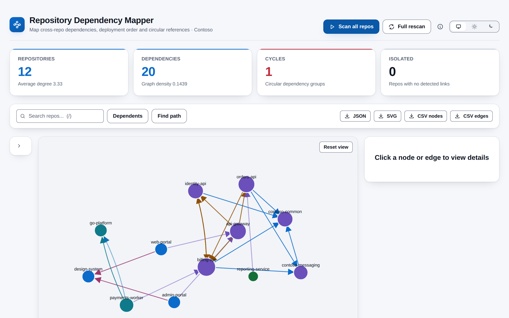
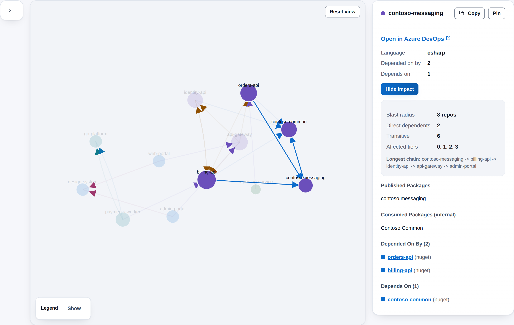

# Repository Dependency Mapper

**Which repositories depend on which, and what breaks if one changes?** Repository Dependency Mapper scans every Git repository in your project, finds the links between them and draws an interactive graph, with circular dependencies flagged, repositories grouped into tiers, and impact and path analysis one click away. It lives under **Repos > Dependencies** and runs entirely in your browser.

## What it detects

| Dependency | Where it looks | Links a repository to... |
|------------|----------------|--------------------------|
| NuGet | `.csproj`, `packages.config`, `Directory.Packages.props` | the repository that publishes the package |
| npm | `package.json` | the repository that publishes the package |
| Go modules | `go.mod` | the repository that owns the module |
| Maven and Gradle | `pom.xml`, `build.gradle` | the repository that publishes the artifact |
| Python | `requirements.txt`, `pyproject.toml`, `setup.py`, `Pipfile` | the repository that publishes the package |
| Docker | `Dockerfile`, `docker-compose.yml` | the repository an image or service is built from |
| Helm | `Chart.yaml`, `values.yaml` | the repository a chart or image comes from |
| API calls | C# HTTP clients, `appsettings*.json` | the repository whose service it calls |
| Databases | connection strings, `DbContext`, stored procedures | other repositories that use the same database |
| Infrastructure | Bicep, ARM, pipelines, PowerShell | repositories it checks out, or shares Azure resources with |
| App Configuration | pipeline YAML | repositories that write to the same store |
| Service connections | pipeline YAML | repositories that use the same service connection |
| Service Bus | C# listeners, pipelines | the repository that provisions a topic, and its other users |
| Shared services | `.csproj`, `appsettings*.json`, C# | repositories that use the same Redis, storage, Cosmos DB and similar instance |

Every link carries a confidence: **High** for an exact match or explicit reference, **Medium** or **Low** for a name-based guess.

## What you get

- **Interactive graph** -- Drag, zoom and pan. Click a repository or a link for details, double-click to open the repository, and pin nodes in place. Edges are coloured by type and fade with confidence.
- **Circular dependencies** -- Every cycle is listed with the weakest link to break.
- **Deployment tiers** -- Repositories layered by how they depend on each other.
- **Impact analysis** -- Pick a repository and see everything that depends on it, directly or through a chain.
- **Path finder** -- The shortest path, or every path, from one repository to another.
- **Search and Dependents** -- Find a repository by name, or light up everything that depends on it.
- **Filters** -- By dependency type, confidence, language and repository.
- **Change banner** -- See which links were added, removed or changed since the previous scan.
- **Exports** -- JSON, SVG and CSV for nodes and edges.
- **Looks like Azure DevOps** -- follows your light, dark or high-contrast theme, with a toggle to pin light or dark. The graph re-themes with the page, types and languages are always named in text, and both palettes meet WCAG AA contrast.

## How it works

1. Open **Repos > Dependencies** and press **Scan all repos**.
2. The extension lists your project's repositories and reads their config, pipeline and infrastructure files (and C# source where useful) directly from your organisation's Azure DevOps REST API, several at a time, with progress you can cancel.
3. Fourteen detectors work out what each repository publishes and what it uses, then link repositories to each other in your browser.
4. The graph, summary tiles, tiers and cycles are built from those links. Press **Full rescan** whenever you want every repository re-read.

## Permissions, in plain words

- **Code (read)** -- to list repositories and read their files and latest commit. The extension never writes to a repository.

## Privacy

All analysis happens in the browser inside the Azure DevOps page. Repository data never leaves your Azure DevOps organisation, nothing is sent to any other service, and there is no telemetry. The last graph and each repository's latest commit are cached in your own browser for 30 minutes, and your theme preference is stored there too.

## Requirements

- Azure DevOps Services, or Azure DevOps Server 2020 or later.
- Permission to read the repositories in the project. Repositories whose files cannot be read contribute no links.
- A modern browser: the graph colours use CSS `color-mix()`.

## Support

Report problems or request features through GitHub Issues: https://github.com/adam-wheater/azure-devops-repo-dependency-mapper/issues

## License

Copyright © 2026 Adam Wheater. All rights reserved. This software is provided under a proprietary source-available license: you may read and audit the code and use the published extension, but you may not copy, modify, redistribute or republish it. See the LICENSE file for the full terms. The open source components it bundles keep their own licenses, listed in THIRD-PARTY-NOTICES.txt inside the package.
